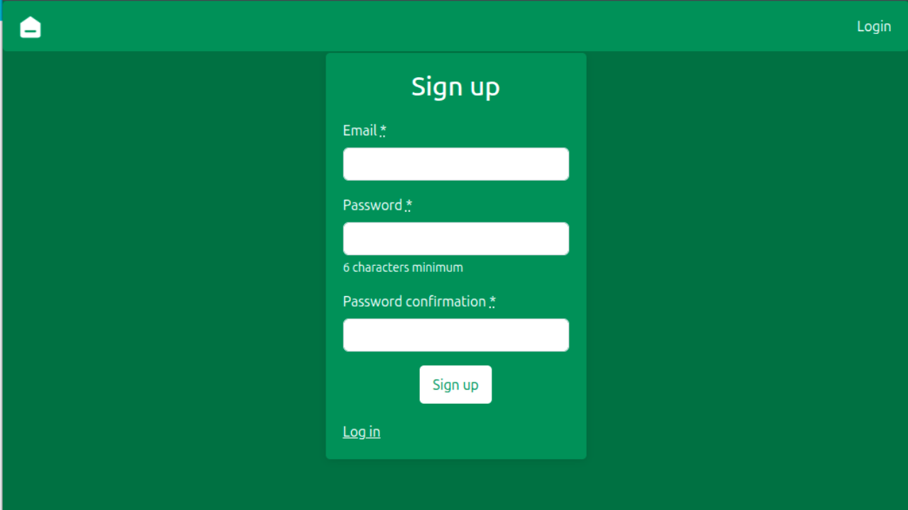
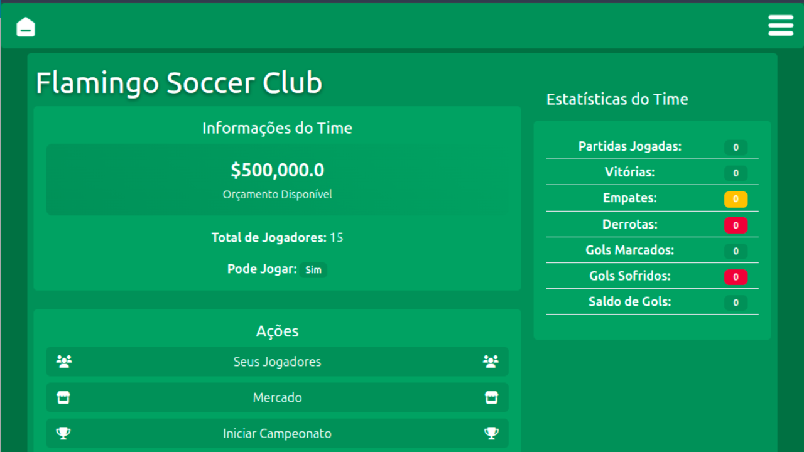
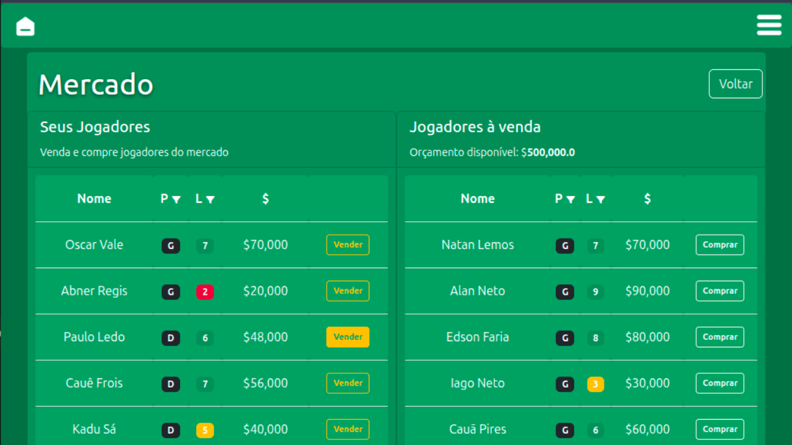
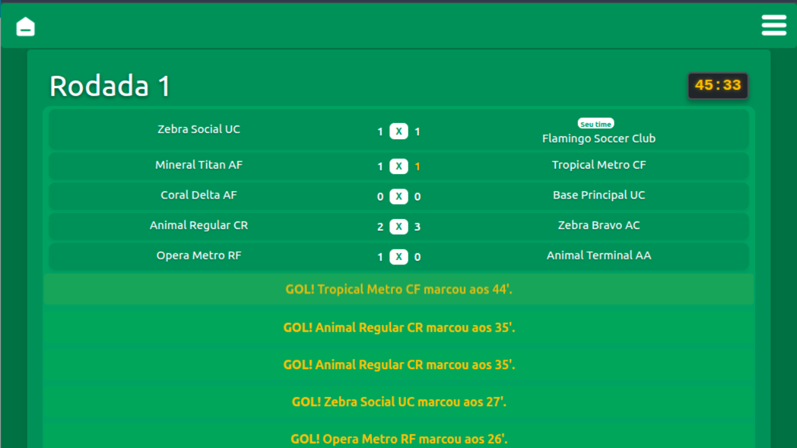

# 🏆 Esporte Mestre

**Esporte Mestre** is a web application for managing sports teams, players, matches, and fantasy sports operations. Built with modern Ruby on Rails and optimized for performance and user experience.

## 🚀 Live Demo
[View the Live Preview here](https://future-puffin-esporte-mestre-a25dd968.koyeb.app/)

## 📷 Preview
   

## 🛠️ Technologies Used

### Core Framework
- **[Ruby on Rails 7.1.5](https://rubyonrails.org/)** - Full-stack web framework
- **[Ruby 3.1.4](https://www.ruby-lang.org/)** - Programming language

### Database
- **[PostgreSQL](https://www.postgresql.org/)** - Primary database
- **SQL** - Database query language

### Frontend Technologies
- **[Bootstrap 5.3.3](https://getbootstrap.com/)** - CSS framework for responsive design
- **[SCSS/SassC](https://sass-lang.com/)** - CSS preprocessor
- **[Stimulus](https://stimulus.hotwired.dev/)** - Lightweight JavaScript framework
- **[Turbo](https://turbo.hotwired.dev/)** - Framework for fast, modern web applications
- **[Import Maps](https://developer.mozilla.org/en-US/docs/Web/HTML/Attributes/importmap)** - Modern JavaScript module system

### Authentication & Security
- **[Devise](https://github.com/heartcombo/devise)** - Flexible authentication solution
- **Rails Security Features** - Built-in CSRF protection and security measures

### Development & Deployment
- **[Docker](https://www.docker.com/)** - Containerization platform
- **[Puma](https://puma.io/)** - Web server for high concurrency
- **[Bootsnap](https://github.com/Shopify/bootsnap)** - Performance optimization
- **[Render](https://render.com/)** - Cloud hosting platform (config/render.yaml)

### Additional Gems & Libraries
- **[Sprockets-rails](https://github.com/rails/sprockets-rails)** - Asset compilation
- **Importmap-rails** - Modern asset pipeline
- **JBuilder** - JSON templating for APIs
- **Simple Form](https://github.com/heartcombo/simple_form)** - Flexible form builder
- **Web Console](https://github.com/rails/web-console)** - Development debugging console

## 📝 Testing
- **[Capybara](https://github.com/teamcapybara/capybara)** - Integration testing framework

## 📋 Features

## 🕹️ User Management
- User registration and authentication via Devise
- Secure login/logout functionality
- User profile management

### Team Management
- Create and manage sports teams
- Team details and statistics
- Team editing and updates

### Player Management
- Player registration and profiles
- Player statistics and performance tracking
- Player-market operations

### Match System
- Match creation and scheduling
- Match results and statistics
- Historical match data

### Market Operations
- Player buying and selling system
- Market transactions
- Real-time market updates

## 🛠️ Installation & Setup

### Prerequisites
- **Ruby 3.1.4**
- **PostgreSQL** (version 9.3 or higher)
- **Docker** (optional, for containerized deployment)

### Local Development Setup

1. **Clone the repository**
   ```bash
   git clone https://github.com/yourusername/esporte-mestre.git
   cd esporte-mestre
   ```

2. **Install Ruby dependencies**
   ```bash
   bundle install
   ```

3. **Database setup**
   ```bash
   # Create and migrate the database
   rails db:create
   rails db:migrate
   rails db:seed
   ```

4. **Start the development server**
   ```bash
   rails server
   ```

5. **Access the application**
   - Open your browser to `http://localhost:3000`

### Docker Setup (Alternative)

1. **Build and run with Docker**
   ```bash
   docker build -t esporte-mestre .
   docker run -p 3000:3000 esporte-mestre
   ```

## 🗄️ Database Schema

The application uses the following main models:

- **Users** - User accounts and authentication
- **Teams** - Sports team management
- **Players** - Player profiles and statistics
- **Matches** - Game/match records
- **Campaigns** - Season/campaign management

## 🎨 Frontend Architecture

### CSS Structure
- **Bootstrap 5.3.3** for responsive design
- **SCSS** for organized styling
- Component-based architecture in `app/assets/stylesheets/`

### JavaScript Architecture
- **Stimulus controllers** for interactive features
- **Turbo** for fast page navigation
- **Import maps** for modern module loading

## 🔧 Configuration

### Environment Variables
- `DATABASE_URL` - PostgreSQL connection string
- `RAILS_MASTER_KEY` - Rails encryption key
- `ESPORTE_MESTRE_DATABASE_PASSWORD` - Database password

### Development Tools
- **Rails Console** - Interactive development environment
- **Rails Logger** - Comprehensive logging system
- **Bootsnap** - Fast application boot times

## 🚀 Deployment

### Render Deployment
The application is configured for easy deployment on Render:

1. Connect your GitHub repository to Render
2. Set environment variables
3. Deploy automatically from the `main` branch

### Manual Deployment
For other platforms:
1. Precompile assets: `rails assets:precompile`
2. Set production environment variables
3. Run database migrations: `rails db:migrate`

## 🧪 Testing

Run the test suite:
```bash
# All tests
rails test

# Integration tests
rails test:integration

# System tests
rails test:system
```

## 📁 Project Structure

```
├── app/
│   ├── controllers/          # Rails controllers
│   ├── models/              # Active Record models
│   ├── views/               # ERB templates
│   ├── javascript/          # Stimulus controllers
│   └── assets/              # CSS, images, fonts
├── config/                  # Configuration files
├── db/                      # Database migrations & schema
├── public/                  # Static assets
└── test/                    # Test files
```

## 🤝 Contributing

1. Fork the repository
2. Create a feature branch (`git checkout -b feature/amazing-feature`)
3. Commit your changes (`git commit -m 'Add amazing feature'`)
4. Push to the branch (`git push origin feature/amazing-feature`)
5. Open a Pull Request

## 📝 License

This project is licensed under the MIT License - see the [LICENSE](LICENSE) file for details.

## 📞 Support

For support, please open an issue in the GitHub repository or contact the development team.

---

**Built with ❤️ using Ruby on Rails and modern web technologies.**
